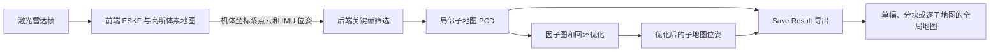

# 地图管理方法

本文说明 kilo-map 当前代码中的地图如何构建、维护和导出。这里的“地图”分为三层：用于实时匹配的前端高斯体素地图、用于后端优化的局部子地图，以及按需生成的全局点云地图。三者用途和保存方式不同。

## 1. 前端：用于实时匹配的高斯体素地图

前端将经过降采样的激光点转换到世界坐标系，并计算点的不确定度。初始化和每帧状态更新后，点被增量插入 `GaussianVoxelMap`。每个父体素可维护平面特征，以及供 NDT 残差使用的子体素均值、协方差和观测噪声；匹配时在当前体素或邻域体素中寻找约束。相关实现见 [`KILO.cc`](../legkilo/src/core/slam/frontend/KILO.cc) 和 [`gaussian_voxel_map.cc`](../legkilo/src/core/slam/frontend/gaussian_voxel_map.cc)。

该地图常驻内存，使用 `capacity` 限制父体素数。插入点时，新建或重新访问的体素被移到 LRU 队列前端；超过容量时移除最久未在**插入流程**中访问的体素。它服务于实时里程计，不是 `Save Result` 输出的全局 PCD；后端回环优化也不会回头重排其中的体素。

## 2. 后端：局部子地图与位姿管理

前端把每帧的**机体（IMU）坐标系点云**、当前 IMU 位姿和时间戳送给后端。第一帧必定是关键帧；之后当相对上一个关键帧的平移或旋转超过 `kf_trans_threshold`、`kf_degree_threshold` 中任一阈值时，才把点云加入当前子地图。非关键帧仍会记录前端位姿。见 [`backend.cc`](../legkilo/src/core/slam/backend/backend.cc)。

子地图的第一帧位姿定义其局部原点。加入关键帧时，使用 `T_子图_帧 = T_世界_子图⁻¹ × T_世界_帧` 把点云变换到**子地图局部坐标系**后累积，因此运行时的 `submap_<id>.pcd` 不是全局坐标点云。子地图达到关键帧数量上限 `kf_max_num_submap`、首末关键帧距离上限 `kf_max_dist_submap`，或后端长时间未收到新帧时结束；停止 SLAM 时也会结束当前非空子地图。完成时以 0.1 m 的体素分辨率降采样，写入压缩二进制 PCD，然后释放内存中的点云；需要时可从 PCD 重新加载。见 [`submap.cc`](../legkilo/src/core/slam/backend/submap.cc)。

每个完成的子地图是因子图的一个节点。后端加入里程计约束、经过验证的回环约束并优化节点位姿。优化结果更新的是子地图的**位姿**；局部 PCD 本身不因回环而重写。运行期间的 `submaps.csv` 同时记录前端原点位姿和当前后端优化位姿，`loop_edges.csv` 记录回环边。后端每次更新都会刷新这些文件，前端逐帧记录则在停止时完整写入 `frontend_frames.csv`。见 [`slam_result_recorder.h`](../legkilo/src/core/slam/tool/slam_result_recorder.h)。

默认运行时目录是编译时 `ROOT_DIR/result/temp/`；配置 `temp_result_save_folder` 可改变最后一级目录名。后端初始化时会清空该运行时目录。目录包含：

| 文件 | 内容 |
| --- | --- |
| `submap_<id>.pcd` | 子地图局部坐标系点云 |
| `submaps.csv` | PCD 路径、前端原点位姿、后端优化位姿 |
| `frontend_frames.csv` | 每帧时间戳、所属子地图、关键帧标记、前端 IMU 位姿 |
| `loop_edges.csv` | 已记录的回环约束 |
| `config.yaml` | 本次运行的配置快照 |

ROS 2 下可运行 `ros2 launch legkilo backend_submaps.py` 查看已完成的后端子地图。对应节点监听运行时 `submaps.csv`，读取局部 PCD，按优化位姿变换到全局坐标后发布彩色点云；若使用了其他 `temp_result_save_folder`，需同步设置节点的 `result_dir` 参数。见 [`backend_submap_publisher_ros2.cc`](../legkilo/src/apps/backend_submap_publisher_ros2.cc)。

## 3. 导出：从子地图生成全局地图

在可视化界面的 **File → Save Result** 中确认后，程序请求停止 SLAM，再打开保存配置窗口。选择输出文件夹，勾选 **save global map enable**，设置坐标类型和地图模式，点击 **Save**。轨迹和 `save SLAM running result enable` 是独立选项。导出器从运行时的 `submaps.csv`、局部 PCD 和配置快照读取数据；输出目录会在写入前被清空，所以应选择专用目录。输出目录不能与运行时目录相同，也不能是其父目录。见 [`save_slam_result_modal.cc`](../legkilo/src/viewer/viewer_modal/save_slam_result_modal.cc) 和 [`slam_result_saver.cc`](../legkilo/src/core/slam/tool/slam_result_saver.cc)。

| 模式 | 输出 | 适用场景 |
| --- | --- | --- |
| **Single** | `global_map/global_map.pcd`、`summary.yaml` | 一次性读取完整点云；导出时会把全部子地图合并到内存 |
| **Tiled** | `map_tiles/clouds/tile_<ix>_<iy>.pcd`、`tile_index.csv`、`tile_scheme.yaml` | 按空间范围加载局部地图 |
| **Submap** | `submaps_global/clouds/submap_<id>.pcd`、`submap_index.csv` | 按子地图管理已变换到全局坐标的点云 |

三种模式都从局部 PCD 读取点云，并使用 `submaps.csv` 中的**后端优化位姿**导出。`Submap` 模式输出的 PCD 已在全局坐标系，不能再用其索引中的位姿重复变换。`Single` 和 `Tiled` 可选择额外的体素降采样；`Submap` 模式没有这一导出选项，但运行时子地图在完成时已经降采样。

### 分块规则

`Tiled` 按全局点的 XY 坐标分块，Z 不参与分块。边长为 `s` 时，块键为 `ix = floor(x/s)`、`iy = floor(y/s)`，负坐标同样按向下取整处理。`tile_index.csv` 记录块编号、XY 边界、中心、点数及相对 PCD 路径；`tile_scheme.yaml` 记录块大小、坐标类型和降采样设置。导出器最多保留 20 个活跃块点云，淘汰时写盘并释放；再次写入同一块会重新加载。所有块写完后，若启用降采样，再逐块处理。界面允许 20–500 m 的块边长，并按 10 m 取整；导出器还会将块边长下限限制为 20 m。分块实现见 [`tiled_map.cc`](../legkilo/src/core/slam/tool/tiled_map.cc)。

### 坐标类型

配置中的 `extrinsic_T`、`extrinsic_R` 表示激光雷达到 IMU 的变换 `T_I_L`。局部子地图的点来自 IMU 坐标系点云。导出器在 **IMU** 模式下使用后端子地图位姿 `T_W_S` 变换局部点；在 **LIDAR** 模式下，当前实现使用 `T_I_L⁻¹ × T_W_S` 变换局部点。轨迹导出的 LIDAR 位姿则使用 `T_W_I × T_I_L`。因此消费地图与轨迹时，应分别遵循导出文件中的 `coord_type` 和实际变换约定，避免再对 PCD 施加一次外参。

导出目录根部还会生成 `manifest.yaml` 和 `README.md`，并复制配置为 `configs/slam.yaml`（前提是运行时配置快照存在）。如果勾选 `save SLAM running result enable`，还会生成 `slam_runtime/`：包含**未变换的局部子地图 PCD**、优化位姿索引、回环边和因子图参数，供离线地图编辑使用。它与上述三种供直接使用的全局地图格式不同。

## 4. 常用参数

以下参数在 [`legkilo/config/`](../legkilo/config/) 的各数据集 YAML 中设置。数值应以实际使用的配置为准。

| 参数 | 作用 |
| --- | --- |
| `voxel_size`、`capacity` | 前端父体素边长、内存中父体素数量上限 |
| `p2plane_enable`、`ndt_enable` | 开启平面或 NDT 匹配约束 |
| `nearby_type` | 匹配搜索范围：`0` 当前体素，`1` 当前加六邻域，`2` 当前加 26 邻域 |
| `kf_trans_threshold`、`kf_degree_threshold` | 后端关键帧平移、旋转阈值 |
| `kf_max_num_submap`、`kf_max_dist_submap` | 子地图结束的关键帧数和首末关键帧距离阈值 |
| `submap_idle_finish_timeout` | 后端空闲结束子地图的等待时间，未配置时默认 1 s |
| `loop_closure_enable` | 是否运行回环检测与回环约束优化 |
| `temp_result_save_folder` | 运行时结果目录在 `result/` 下的名称，未配置时为 `temp` |

**选择建议：**需要整张点云文件时选 `Single`；需要按 XY 范围加载时选 `Tiled`；需要以子地图为单位查看或处理全局点云时选 `Submap`；需要保留可重新调整子地图位姿的原始材料时同时勾选 `save SLAM running result enable`。
